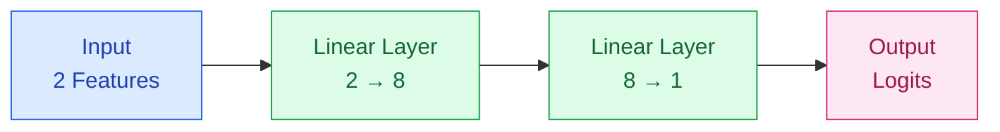
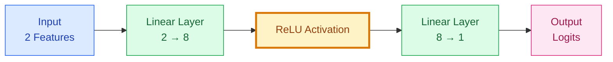
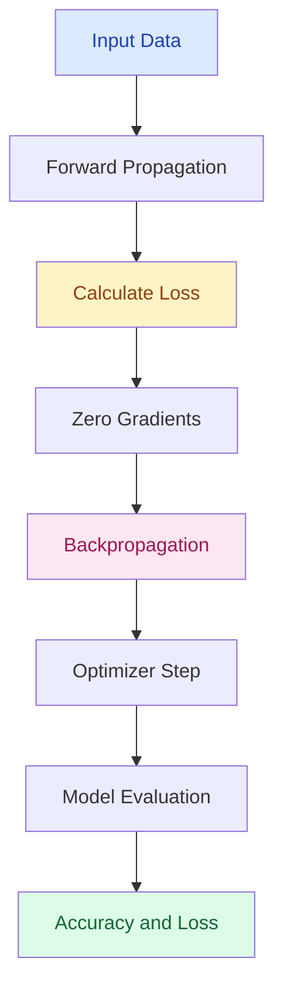

# 🧠 Linear vs Non-Linear Binary Classification with PyTorch

<div align="center">


**Exploring how activation functions transform neural network decision boundaries.**

A comparative deep learning project implementing linear and ReLU-based neural networks for binary classification.

</div>

---

## 📌 Project Overview

This project explores the differences between **linear and non-linear neural networks** using PyTorch.

Three models are trained across two classification datasets to investigate how network architecture and ReLU activation affect classification performance.

**Project objectives:**

- Build neural networks from scratch using PyTorch.
- Implement binary classification with `nn.Module`.
- Compare linear and non-linear neural networks.
- Understand the role of ReLU activation functions.
- Visualize decision boundaries.
- Evaluate training and testing performance.

---

## 📊 Datasets

### 📧 Dataset 1 — Email Classification

**File:** `08-email_classification_svm.csv`

| Property | Description |
|---|---|
| Samples | 1,000 |
| Training Samples | 800 |
| Testing Samples | 200 |
| Feature 1 | `subject_formality_score` |
| Feature 2 | `sender_relationship_score` |
| Target | `email_type` |
| Task | Binary Classification |

This dataset is used to demonstrate how a linear neural network learns a classification boundary.

### 🌍 Dataset 2 — Seismic Activity Classification

**File:** `08-seismic_activity_svm.csv`

| Property | Description |
|---|---|
| Samples | 400 |
| Training Samples | 320 |
| Testing Samples | 80 |
| Feature 1 | `underground_wave_energy` |
| Feature 2 | `vibration_axis_variation` |
| Target | `seismic_event_detected` |
| Task | Binary Classification |

This dataset contains non-linear classification patterns and is used to compare linear and ReLU-based neural networks.

---

## 🏗️ Neural Network Architectures

### Model 1 — Linear Neural Network (Email Classification)


The model learns a linear decision boundary using two fully connected layers without activation functions.

### Model 2 — Linear Neural Network (Seismic Classification)



Even with multiple linear layers, the network remains equivalent to a single linear transformation when no non-linear activation function is applied.

### Model 3 — Non-Linear Neural Network (ReLU)



The ReLU activation function introduces non-linearity, enabling the network to learn more complex decision boundaries.

**ReLU equation:**

\[
ReLU(x) = \max(0,x)
\]

---

## ⚙️ Training Configuration

| Parameter | Configuration |
|---|---|
| Framework | PyTorch |
| Loss Function | BCEWithLogitsLoss |
| Optimizer | SGD |
| Learning Rate | 0.01 |
| Epochs | 500 |
| Train/Test Split | 80% / 20% |
| Random Seed | 42 |
| Classification Threshold | 0.5 |

The training process follows these steps:



---

## 📈 Experimental Results

The following results are from the last logged epochs in the notebook.

| Model | Train Accuracy | Test Accuracy |
|---|---:|---:|
| 📧 Email — Linear | 98.88% | **98.50%** |
| 🌍 Seismic — Linear | 52.19% | 41.25% |
| 🧠 Seismic — ReLU | 65.63% | **75.00%** |

### Key Findings

**1. Linear Classification on Email Data**

The linear neural network achieves high classification accuracy on the email dataset.

**2. Linear Classification on Seismic Data**

The linear model struggles with the non-linear classification pattern and produces relatively low accuracy.

**3. Non-Linear Classification with ReLU**

Adding ReLU improves test accuracy on the seismic dataset.

The ReLU model achieves **75.00% test accuracy**, compared with **41.25%** for the linear model under the tested configuration.

This represents a **33.75 percentage-point improvement** in test accuracy.

These results illustrate the importance of activation functions in neural networks.

---

## 🎯 Decision Boundary Visualization

Decision boundaries are visualized for both training and testing data.

### Linear Decision Boundary

The linear model combines the effective weights and biases of consecutive linear layers.

\[
W_{effective} = W_2 W_1
\]

\[
b_{effective} = W_2b_1 + b_2
\]

The decision boundary is calculated from:

\[
w_1x_1 + w_2x_2 + b = 0
\]

### Non-Linear Decision Boundary

For ReLU-based models, decision boundaries are visualized by generating a two-dimensional mesh grid and evaluating the model's predictions across the grid.

This allows curved or piecewise-linear decision boundaries to be displayed.

The notebook includes visual comparisons of training and test predictions.

---

## 🛠️ Technologies Used

| Technology | Purpose |
|---|---|
| Python | Programming language |
| PyTorch | Neural network development |
| NumPy | Numerical operations |
| Pandas | Data processing |
| Matplotlib | Data visualization |
| Seaborn | Statistical visualization |
| Scikit-learn | Data splitting and preprocessing |
| Jupyter Notebook | Development environment |

---

## 📂 Project Structure

```text
pytorch-binary-classification/
│
├── LinearvsNonLinear.ipynb
│
├── 08-email_classification_svm.csv
│
├── 08-seismic_activity_svm.csv
│
└── README.md
```

---

## 🚀 Getting Started

### 1. Clone the Repository

```bash
git clone https://github.com/onursvm/pytorch-binary-classification.git
cd pytorch-binary-classification
```

### 2. Install Dependencies

```bash
pip install torch numpy pandas matplotlib seaborn scikit-learn notebook
```

### 3. Launch Jupyter Notebook

```bash
jupyter notebook LinearvsNonLinear.ipynb
```

### 4. Run the Experiments

Run the notebook cells sequentially to:

- Load and explore the datasets.
- Define neural network architectures.
- Train linear and non-linear models.
- Calculate loss and accuracy.
- Visualize classification boundaries.
- Compare model performance.

---

## 💡 What I Learned

Through this project, I gained hands-on experience with:

- Building neural network architectures with `torch.nn.Module`.
- Understanding linear and non-linear transformations.
- Applying ReLU activation functions.
- Implementing forward and backward propagation.
- Training neural networks using SGD.
- Using `BCEWithLogitsLoss` for binary classification.
- Measuring model performance.
- Visualizing decision boundaries.
- Understanding the limitations of purely linear models.

---

## 🔮 Future Improvements

- Experiment with Adam and other optimizers.
- Compare ReLU, Tanh, and Sigmoid activation functions.
- Investigate deeper neural networks.
- Add confusion matrices and classification reports.
- Evaluate precision, recall, and F1-score.
- Perform hyperparameter tuning.
- Explore regularization and generalization.

---

## 👨‍💻 Author

**Onur Sevim**

Computer Engineering | Machine Learning & Deep Learning

[](https://github.com/onursvm)

---

<div align="center">

**Built with Python & PyTorch**

*Exploring the power of non-linear neural networks.*

</div>
